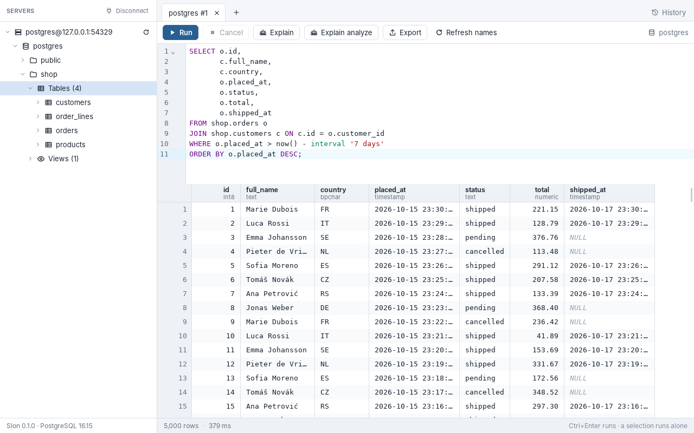
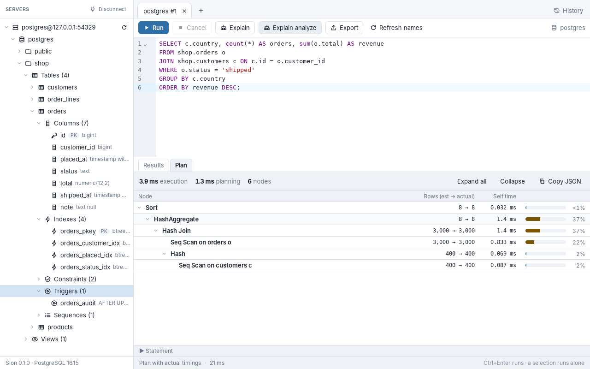
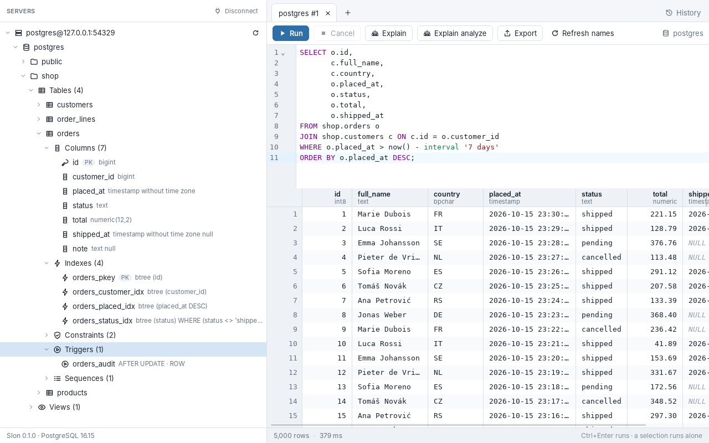
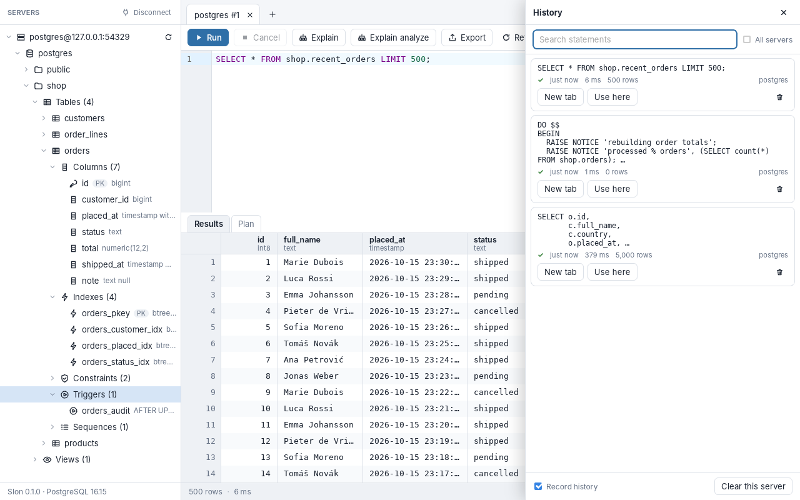

# Slon

A small, fast PostgreSQL client for Windows. Rust backend, TypeScript/Svelte frontend, packaged with
[Tauri 2](https://tauri.app). It uses the WebView2 runtime that Windows already ships, so the
installer is about 2 MB and there is no bundled browser.

The name is Serbian for *elephant*.



This is a **vertical slice**, not a pgAdmin clone. It does these things and tries to do them well:

| | |
|---|---|
| Connect | host, port, database, user, password; SSL modes including **certificate verification** (`verify-ca`, `verify-full`, CA file or Windows certificate store); structured errors (message, detail, hint, SQLSTATE) |
| Saved connections | named profiles; passwords in the OS credential store, never in a file |
| Browse | lazy tree of databases → schemas → tables / views; expand a table for **columns, indexes, constraints, triggers and sequences**; right-click for a **CREATE script**, a SELECT template, or to browse the first rows |
| Edit | CodeMirror 6 editor with PostgreSQL syntax highlighting; `Ctrl+Enter` / `F5` runs, a selection runs alone; **schema-aware autocomplete** |
| Results | virtualized grid, type-aware **client-side sorting**, streamed in batches; cell and row **selection and copy** (tab-separated, pastes into Excel); **resizable columns** |
| Explain | **Explain** and **Explain analyze** in a plan tree with per-node time share, bad row estimates, spills to disk and other warnings |
| Messages | `RAISE NOTICE`, warnings and `VACUUM VERBOSE` output in their own tab, live while the statement runs |
| Export | the grid's rows as **CSV, TSV, JSON or JSON Lines**, in the sorted order shown |
| History | every statement you ran, searchable, reopened in a tab (`Ctrl+H`); password-looking statements are never recorded |
| Tabs | multiple query tabs, one dedicated connection each; real server-side **cancellation**; tabs come back when you reconnect to the same server |

<table>
<tr>
<td width="33%"><br><sub><b>Explain analyze</b> — self time per node, estimate vs actual, warnings</sub></td>
<td width="33%"><br><sub><b>Table properties</b> — columns, indexes, constraints, triggers, sequences</sub></td>
<td width="33%"><br><sub><b>Query history</b> — searchable, reopened in a tab</sub></td>
</tr>
</table>

## Install

Download the installer from [Releases](../../releases) and run it:

- **`Slon_<version>_x64-setup.exe`** (NSIS) installs for the current user and needs no admin rights. Use this one.
- **`Slon_<version>_x64_en-US.msi`** installs per machine and needs admin rights. Use it for managed rollouts.

The binaries are not code-signed yet, so Windows SmartScreen will warn the first time. Choose
*More info* → *Run anyway*.

## Build from source

Prerequisites: [Rust](https://rustup.rs) (MSVC toolchain), the *Desktop development with C++* build
tools, and Node 20+. WebView2 ships with Windows 10/11.

```powershell
npm install
npm run tauri dev       # development, hot reload
npm run tauri build     # installers (NSIS + MSI) under target\release\bundle
```

On Linux, install the Tauri system packages first (`libwebkit2gtk-4.1-dev`, `libgtk-3-dev`,
`librsvg2-dev`, `libsoup-3.0-dev`, `patchelf`).

## Tests

```bash
npm test                                   # sorting, plans, export, history helpers (vitest)
npm run check                              # svelte-check / TypeScript
cargo test -p pg-profiles                  # saved connections (in-memory credential store)
cargo test -p pg-profiles -- --ignored     # the same API against the REAL credential store

eval "$(scripts/test-db.sh start)"         # throwaway PostgreSQL with TLS (private CA) on :54329
SLON_REQUIRE_DB=1 cargo test -p pg-core    # engine tests against that server
scripts/test-db.sh stop
```

`SLON_REQUIRE_DB=1` makes a missing database a failure instead of a silent skip. `test-db.sh` needs
bash and the PostgreSQL server binaries; on Windows, point the `SLON_TEST_HOST/PORT/USER/PASSWORD/DB`
variables at any server you have instead.

End-to-end (Linux; drives the real app through `tauri-driver`):

```bash
cargo install tauri-driver --locked
sudo apt install webkit2gtk-driver xvfb
npx tauri build --debug --no-bundle
cd e2e && npm install && xvfb-run -a node run.mjs     # with the SLON_TEST_* variables set
```

## Layout

```
crates/pg-core/   PostgreSQL engine: connections, catalog queries, streaming execution, cancel.
                  No UI dependencies; tested against a real server.
crates/pg-profiles/
                  Saved connections (profiles.json + the OS credential store), query history
                  (history.json) and remembered tabs (workspaces.json).
src-tauri/        Thin Tauri shell: exposes pg-core as commands, streams results over a Channel.
src/              Svelte 5 + TypeScript UI (store.svelte.ts holds the app state).
e2e/              WebDriver test that drives the real binary.
scripts/          test-db.sh starts a throwaway PostgreSQL cluster for the tests.
```

- [docs/DESIGN.md](docs/DESIGN.md) — why it works the way it does: the query protocol, cancellation,
  TLS modes, the plan view, where secrets live.
- [docs/STATUS.md](docs/STATUS.md) — current state, what is verified where, and the to-do list.

## Not done yet

- Import/export of saved connections, folders/groups
- Client certificates, SSH tunnels, `.pgpass` / service files
- `COPY` (the protocol-level kind used by `COPY ... FROM STDIN`)
- Copy as INSERT/JSON, export of *all* rows of a result larger than the 100,000-row grid cap (needs a re-run)
- Autocomplete for CTEs/subqueries, functions and types
- Grants, rules, policies in table properties
- Code-signed installers

## License

[MIT](LICENSE).
